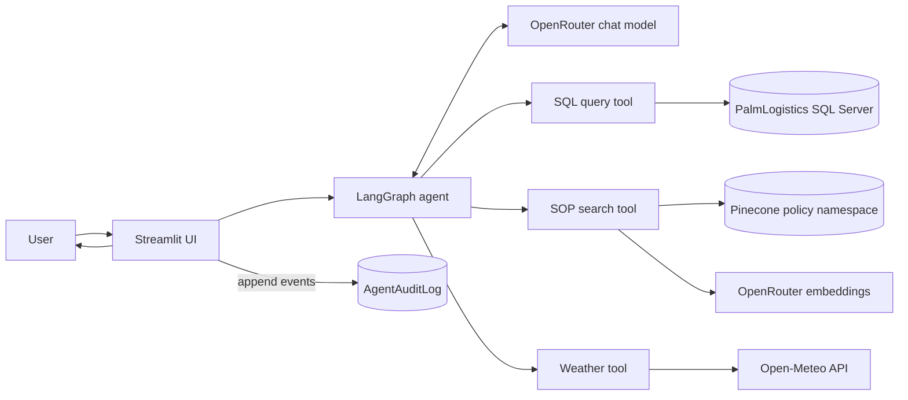
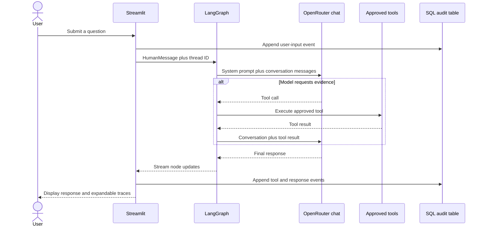
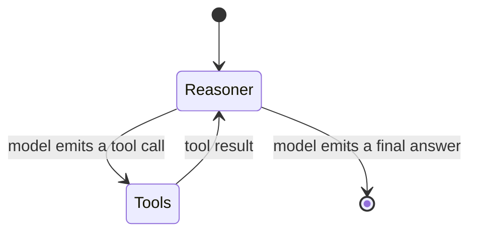
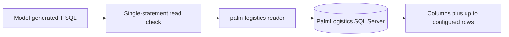
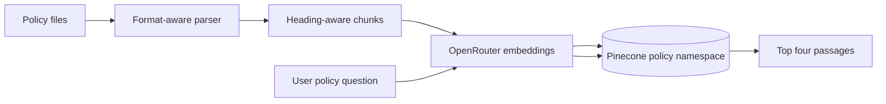
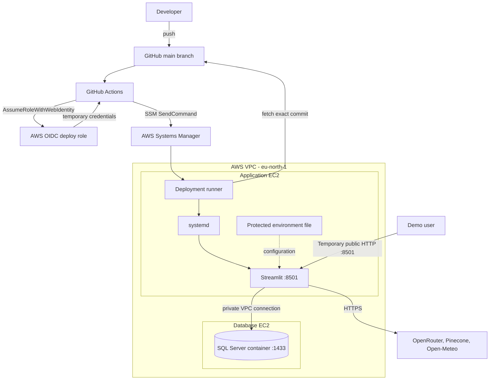
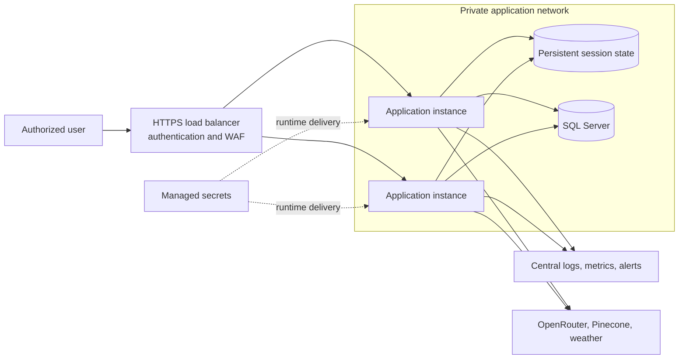

# Palm Logistics AI Assistant Architecture

Last updated: 2026-10-20

## 1. Purpose

Palm Logistics is a Streamlit operations assistant that combines four evidence
sources in one conversational workflow:

- operational records from SQL Server;
- operating guidance from the Palm Logistics SOP in Pinecone;
- current corridor weather from Open-Meteo; and
- model reasoning through OpenRouter.

The assistant provides evidence and recommendations. It does not modify
operational records or execute logistics decisions.

This document separates the system that is implemented today from the target
production architecture. Planned implementation work is tracked in
`docs/roadmap.md`.

## 2. Current high-level design

There is one Python application process. Streamlit imports the compiled
LangGraph agent, and the agent imports the three tools. There is no separate API
service, authentication service, response-composer service, or tracing service
in the current implementation.

## 3. Implemented components

| Component | Source | Current responsibility |
|---|---|---|
| Streamlit UI | `src/ui.py` | Chat interface, session state, streamed graph events, tool trace display, and audit viewer |
| Agent orchestration | `src/orchestrator.py` | OpenRouter chat model, system prompt, LangGraph reasoner/tool loop, and in-memory checkpoints |
| System instructions | `src/prompts/system_prompt.txt` | Evidence-use rules, response behavior, and operating boundaries |
| SQL tool | `src/agent_tools.py` | Executes one accepted `SELECT` or `WITH` T-SQL statement and displays at most the configured row limit |
| SOP tool | `src/agent_tools.py` | Retrieves the four most relevant SOP passages from Pinecone with source and section metadata |
| Weather tool | `src/agent_tools.py` | Retrieves current temperature, wind, weather code, coordinates, and observation time from Open-Meteo |
| Policy ingestion | `scripts/ingest_sop_pinecone.py` | Parses policy files, chunks content, creates embeddings, and incrementally synchronizes Pinecone |
| Audit writer/viewer | `src/ui.py` | Appends interaction events with the application identity and reads them using separately entered SQL credentials |
| Deployment runner | `scripts/deploy_app.sh` | Deploys an exact commit, synchronizes dependencies, restarts the service, verifies dependencies, and rolls back failures |
| Runtime service | `infrastructure/systemd/palm-logistics.service` | Runs Streamlit as the restricted `palmapp` Linux user |

## 4. Application request flow

### Current graph behavior

The implemented graph is intentionally small:

- `AgentState` contains only the message history.
- `MemorySaver` stores conversation checkpoints in application memory.
- The Streamlit session supplies the LangGraph thread ID.
- Restarting the application removes checkpoint memory.
- The model chooses whether to call SQL, SOP search, weather, or no tool.
- The reasoner may repeat the tool loop; an explicit graph-step budget is not yet implemented.
- Response structure and evidence discipline are directed by the system prompt.

## 5. Evidence paths

### 5.1 Operational SQL

Current controls:

- the query must begin with `SELECT` or `WITH`;
- embedded statement separators and blocked SQL keywords are rejected;
- the SQL login has `db_datareader` access and no general write role;
- stored-procedure execution is denied;
- the tool fetches no more than `SQL_RESULT_LIMIT` rows for display;
- the reader can insert into `dbo.AgentAuditLog`; and
- the reader cannot select, update, or delete audit records.

Current limitations:

- validation is keyword-based rather than parser-based;
- the model generates T-SQL instead of selecting from approved query templates;
- `db_datareader` is broader than a production semantic-view role; and
- the display limit does not impose a database execution-cost limit on the query.

### 5.2 Policy retrieval

The ingestion pipeline supports Markdown, text, PDF, CSV, and XLSX. Markdown is
split by headings before recursive chunking. Each vector records source,
format, document type, and available section metadata. A per-index content-hash
cache skips unchanged files and removes vectors for changed or deleted files.

The application uses the same embedding model, dimensions, Pinecone index, and
namespace for ingestion and retrieval. Retrieval currently returns `k=4`
passages.

### 5.3 Weather context

The weather tool calls Open-Meteo with explicit latitude and longitude. It
returns current observation time, air temperature, wind speed, and weather
code. Its output is external context and is not treated as shipment telemetry.

### 5.4 Audit events

The UI writes these event types to `dbo.AgentAuditLog`:

- user input;
- model tool requests and arguments;
- tool outputs;
- final model responses; and
- application errors.

The application reader has append-only access to this table. Audit Logs mode
creates a separate SQL connection using credentials entered for that request.
Those credentials are not stored in Streamlit session state.

The current audit content is free-form and may include full prompts, tool
arguments, tool outputs, responses, and error text. Structured event schemas,
redaction, retention controls, and a dedicated audit-reader identity remain
production work.

## 6. Current AWS deployment

### Runtime inventory

| Item | Current value |
|---|---|
| AWS region | `eu-north-1` |
| Application EC2 | `i-0abf621413feb57f3` (`palm-logistics-app`) |
| Application private IP | `172.31.35.127` |
| Current application public IP | `13.60.234.167` |
| Application process | Streamlit managed by `palm-logistics.service` |
| Linux identity | `palmapp` |
| Runtime configuration | `/etc/palm-logistics/palm-logistics.env`, mode `0640`, owner `root:palmapp` |
| Database EC2 | `i-0f40d0e804c8e423b` (`palm-logistics-database`) |
| Database private endpoint | `172.31.34.242:1433` |
| Administration | AWS Systems Manager; no inbound SSH |

The current public endpoint is a temporary demonstration exception. Streamlit
listens on `0.0.0.0:8501`, and security-group rule
`sgr-0cfb02a8327b4e741` permits public IPv4 access to that port. The endpoint is
HTTP-only and has no front-door authentication.

## 7. Deployment flow

Every push to `main` starts the deployment workflow:

1. GitHub Actions checks out the exact commit.
2. `uv sync --frozen` installs the locked environment.
3. Python compilation and shell syntax checks run.
4. GitHub obtains temporary AWS credentials through repository- and environment-scoped OIDC trust.
5. GitHub sends the commit SHA to the `PalmLogistics-Deploy` SSM document.
6. The EC2 runner fetches and validates the commit, checks it out, and synchronizes dependencies.
7. systemd restarts Streamlit.
8. The runner checks local Streamlit health, SQL connectivity, OpenRouter embeddings, and the Pinecone namespace.
9. A failed deployment attempts to restore and revalidate the previous commit.

The deploy role can send only the approved document to the application instance.
Permanent AWS access keys are not stored in GitHub.

## 8. Security boundaries and known gaps

| Area | Implemented boundary | Known gap |
|---|---|---|
| Public access | Security group controls ingress; SSH is closed | Temporary port `8501` is open to everyone over HTTP |
| User identity | None at the application entrance | No authentication or role mapping |
| Database network | SQL `1433` is allowed from the application security group | Independent external reachability verification remains open |
| Database permissions | Read access, denied procedure execution, narrow audit insert | Reader can access more tables than a production semantic view should expose |
| SQL validation | One `SELECT`/`WITH` statement and blocked-keyword filter | No SQL parser, allowlisted views, or execution-cost controls |
| Secrets | Ignored local `.env`; protected EC2 environment file | No managed secret store or automated rotation |
| SQL transport | Private VPC path | SQL encryption is disabled for the current container |
| Audit | Append-only application writes and separate read identity | Free-form content, no redaction pipeline, retention policy, or dedicated audit-reader role |
| Agent safety | Restricted tools, system instructions, and database permissions | No deterministic evidence schema, graph budget, or automated safety evaluation gate |
| State | Per-thread in-memory checkpoints | State is lost on restart and cannot support multiple instances |
| Availability | systemd restarts one application process | Single EC2 instance and single database instance |

Do not enter privileged SQL credentials through the temporary public HTTP
endpoint. Secure-demo and production remediation tasks are ordered in
`docs/roadmap.md`.

## 9. Failure behavior

| Failure | Current behavior |
|---|---|
| SQL query rejected | Tool returns a security-block message |
| SQL unavailable or query fails | Tool returns a database failure message to the agent |
| SOP retrieval empty | Tool returns an explicit no-match message |
| Pinecone failure | Tool returns an SOP retrieval failure message |
| Weather failure | Tool returns an external-weather failure message |
| OpenRouter failure | Streamlit displays and audits an agent error |
| Audit insert failure | Error is written to server output; the user request continues |
| Deployment health or dependency failure | Deployment runner attempts rollback to the previous commit |
| EC2 application restart | systemd starts Streamlit; in-memory conversations are lost |
| Database EC2 stopped | UI may load, but SQL-backed requests and deployment smoke tests fail |

Tool failures are currently returned as text for the model to interpret. Typed
error categories, circuit breakers, and dependency-aware response policies are
future improvements.

## 10. Target production architecture

Production evolution includes:

- a controlled domain, HTTPS, WAF, and enterprise authentication;
- private application instances across multiple Availability Zones;
- no public application-instance IP addresses;
- persistent session/checkpoint state;
- approved SQL semantic views and trusted SQL TLS;
- managed secrets and rotation;
- structured and redacted audit events;
- centralized logs, metrics, alerts, backups, and recovery tests; and
- automated quality, safety, security, latency, and cost gates.

## 11. Architecture decisions

| Decision | Reason | Current consequence |
|---|---|---|
| Streamlit monolith for the first release | Keeps the interaction, graph streaming, and audit experience simple | UI, orchestration, and audit concerns share one process |
| LangGraph reasoner/tool loop | Supports iterative tool use with visible node events | Tool choice and stopping behavior depend on the model and prompt |
| SQL reader plus code validation | Provides defense in depth around model-generated SQL | The current reader and validator require tighter production boundaries |
| Retrieval over full-policy prompting | Keeps model context focused and preserves passage attribution | Retrieval quality depends on ingestion, embeddings, metadata, and ranking |
| OpenRouter for chat and embeddings | Provides one OpenAI-compatible model gateway | Availability, model changes, cost, and data handling depend on an external provider |
| Pinecone namespace for policy | Separates policy vectors from other vector workloads | Ingestion and retrieval configuration must remain identical |
| Systems Manager instead of SSH | Removes the need for inbound administrative access | Instance administration depends on SSM and the EC2 role |
| GitHub OIDC instead of AWS keys | Uses short-lived deployment credentials | Trust policy and GitHub environment configuration must remain aligned |
| Exact-commit deployment with rollback | Makes releases traceable and recoverable | Deployment succeeds only when health and dependency checks pass |
| Human authority for operational action | Limits automation risk | The assistant recommends; authorized personnel decide and act |
