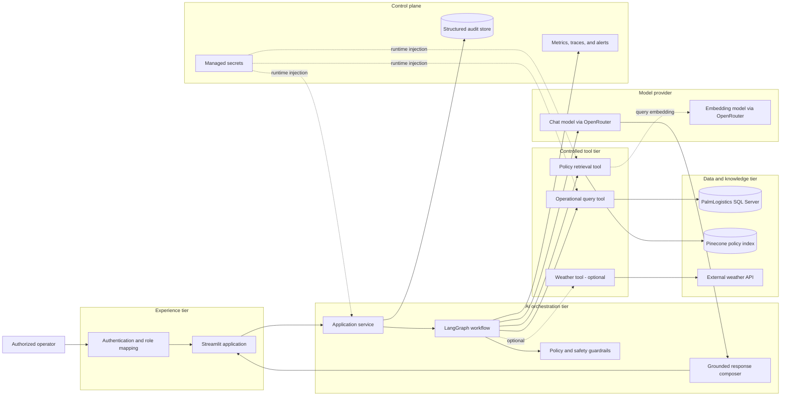
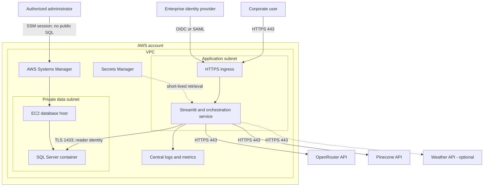
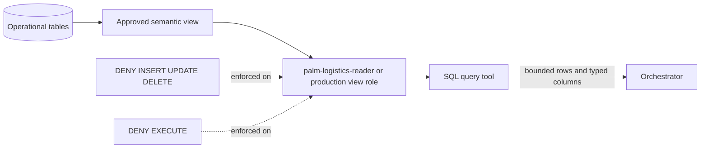
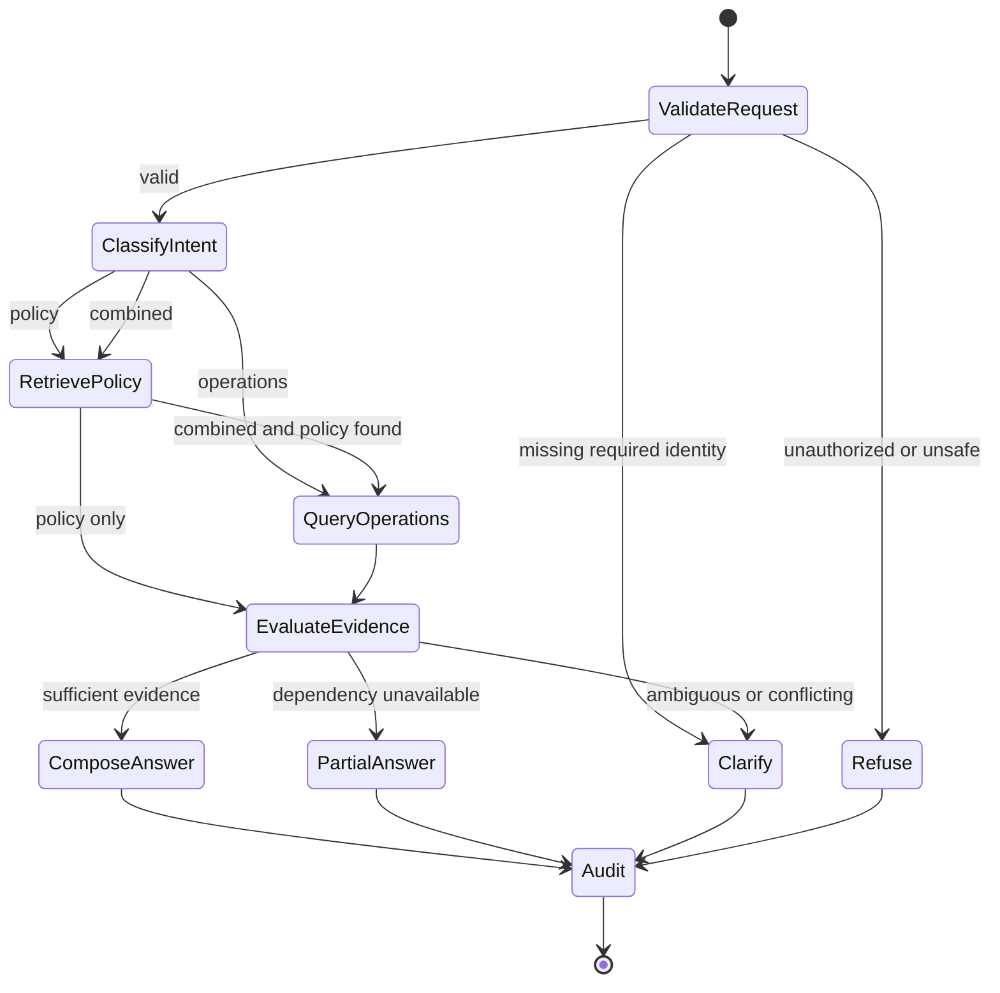
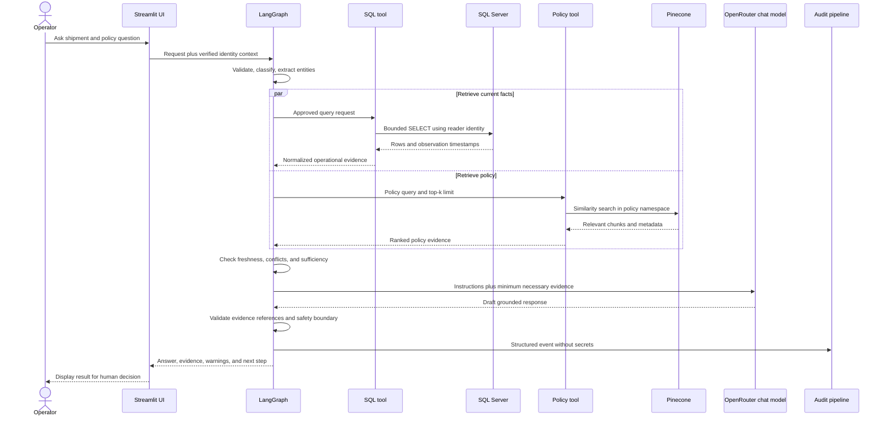

# Palm Logistics AI Operations Assistant

## System architecture

| Document item | Value |
|---|---|
| Architecture scope | Operator assistant, operational data access, policy retrieval, and AI orchestration |
| Status | Current foundation plus target application design |
| Primary platform | Python, Streamlit, LangGraph, SQL Server, Pinecone, OpenRouter, and AWS |
| Security posture | Read-only tools, private database connectivity, human approval, and auditable execution |

> This architecture describes a synthetic demonstration system. “Current” means implemented in this repository or verified in its supporting environment. “Target” means required before a production deployment.

## 1. Architecture goals

The system must:

- answer policy, operational, and combined questions through one interface;
- ground every operational claim in a tool result;
- keep the language model outside the database security boundary;
- prevent the assistant from modifying operational systems;
- make uncertainty, freshness, and missing evidence visible;
- support deterministic testing around a probabilistic model; and
- preserve an auditable record without logging credentials or unnecessary sensitive data.

## 2. Design principles

1. **Tools enforce authority.** Prompts describe behavior, but code, database permissions, and network policy enforce it.
2. **Read before reason.** Current status comes from SQL; policy comes from the approved vector index.
3. **Separate facts from policy.** Responses label observations, policy requirements, inference, and recommendations.
4. **Human decisions remain human.** The assistant cannot reroute, release, discard, or communicate externally.
5. **Fail closed.** Missing or contradictory evidence produces an unavailable or inconclusive result.
6. **Bound every operation.** Queries, retries, result sizes, graph steps, and external calls have explicit limits.
7. **Version the knowledge path.** Source file, content hash, embedding model, index, namespace, and ingestion time are traceable.
8. **Minimize sensitive context.** Only the fields and passages needed for a task enter the model context.

## 3. Current and target state

| Capability | Current state | Target state |
|---|---|---|
| Policy source | Versioned Markdown SOP | Approved policy publishing workflow with owner and effective date |
| Policy ingestion | Incremental Python ingestion with header-aware chunking | Scheduled ingestion with manifest, metrics, and deployment promotion |
| Embeddings | OpenRouter `openai/text-embedding-3-small`, 1,536 dimensions | Version-pinned configuration with evaluation before model changes |
| Vector store | Pinecone index `palm-logistics-sop`, namespace `policy` | Environment-separated indexes or namespaces with backup/export procedure |
| Operational store | SQL Server `PalmLogistics` | Same, with approved semantic views for assistant access |
| SQL identity | `palm-logistics-reader`; reads allowed, writes and execution denied | View-only custom role, rotation, and managed secret delivery |
| Administration | AWS Systems Manager port forwarding | Same pattern for administration; no public SQL endpoint |
| Application | Dependencies and data foundation present | Authenticated Streamlit interface and LangGraph orchestration service |
| Audit | Not yet implemented | Structured append-only event pipeline with redaction and retention |
| Weather | Not yet implemented | Optional tool with freshness, provenance, timeout, and fallback rules |

## 4. High-level design

### 4.1 Logical architecture



### 4.2 Component responsibilities

| Component | Responsibility | Must not do |
|---|---|---|
| Streamlit application | Capture user intent, display evidence and status, maintain presentation session | Hold database administration credentials or implement business rules |
| Application service | Authenticate request context, create correlation ID, enforce limits | Trust client-supplied roles or expose secrets |
| LangGraph workflow | Route, call tools, manage bounded state, and handle recovery | Expand its own permissions or bypass tool validation |
| Operational query tool | Produce safe, bounded reads from approved SQL objects | Execute writes, procedures, multi-statement SQL, or unbounded queries |
| Policy retrieval tool | Embed the query and return relevant SOP chunks and metadata | Treat retrieved text as executable instructions |
| Response composer | Convert verified evidence into a useful answer | Invent missing facts or hide uncertainty |
| Audit pipeline | Record structured execution evidence and security events | Store passwords, access keys, full connection strings, or unnecessary personal data |

## 5. Deployment architecture

### 5.1 Target runtime topology



### 5.2 Network rules

- Public ingress is HTTPS only and terminates at an approved ingress component.
- SQL Server has no public endpoint.
- SQL port 1433 accepts traffic only from the application security group and approved SSM administrative sessions.
- Administrative access uses AWS Systems Manager rather than inbound SSH or a public database rule.
- Outbound HTTPS is restricted to approved model, vector, weather, identity, logging, and update endpoints where practical.
- Development port forwarding is not the production application connection pattern.

## 6. Data architecture

### 6.1 Operational data path



The present reader has database-wide read membership. That is acceptable for the controlled demonstration but is broader than the preferred production boundary. Production should expose an approved semantic schema or view containing only the fields required by assistant use cases, then grant `SELECT` on that surface instead of all user tables.

### 6.2 Policy knowledge path

```mermaid
flowchart LR
    SOP[Approved SOP files]
    PARSE[Format-aware parser]
    HEAD[Markdown heading splitter]
    CHUNK[Recursive splitter: 600 chars, 60 overlap]
    META[Source and heading metadata]
    EMBED[OpenRouter embedding request]
    VECTOR[1,536-dimensional vectors]
    INDEX[(Pinecone: palm-logistics-sop / policy)]
    CACHE[Per-index content-hash cache]

    SOP --> PARSE --> HEAD --> CHUNK --> META --> EMBED --> VECTOR --> INDEX
    SOP --> CACHE
    CACHE -->|skip unchanged files| PARSE
    CACHE -->|remove replaced or deleted source vectors| INDEX
```



Current ingestion properties:

- Markdown is first separated by `#`, `##`, and `###` headings.
- Long sections are split into approximately 600-character chunks with 60-character overlap.
- Every vector includes source filename, file format, document type, and available heading metadata.
- IDs are deterministic per source file and chunk position.
- A content-hash cache avoids re-embedding unchanged documents.
- A failed ingestion is not marked complete and is retried later.
- Index dimension mismatch stops the process; the script does not delete the index automatically.

### 6.3 Information classification

| Data | Classification | Model exposure rule |
|---|---|---|
| Synthetic SOP | Internal demonstration | Relevant passages only |
| Synthetic operational telemetry | Internal demonstration | Minimum fields and rows required |
| User prompt | Internal | Redact secrets before provider calls or logs |
| Driver or customer personal data | Restricted | Exclude unless explicitly approved and necessary |
| Credentials and connection strings | Secret | Never send to a model, vector store, trace, or prompt |
| Tool audit metadata | Internal/security | Structured, access-controlled, and retention-bound |

## 7. Low-level orchestration design

### 7.1 Agent state

The graph state should be explicit and serializable.

```text
RequestState
  request_id: UUID
  user_id: string
  user_roles: list[string]
  question: string
  intent: policy | operations | combined | unsupported
  entities:
    shipment_id: optional string
    time_range: optional object
    location: optional string
  tool_budget_remaining: integer
  evidence: list[EvidenceItem]
  warnings: list[string]
  answer: optional string
  outcome: success | partial | clarification | refused | failed
```

An `EvidenceItem` contains the source type, retrieval timestamp, observation timestamp when applicable, reference metadata, normalized content, and sensitivity label. It does not contain secrets or unrestricted raw database dumps.

### 7.2 Graph flow



### 7.3 Request sequence



## 8. Tool contracts

### 8.1 Policy retrieval

```text
search_policy(
  query: string,
  top_k: integer = 5,
  filters: optional object
) -> list[PolicyEvidence]
```

Controls:

- enforce a small maximum `top_k`;
- restrict searches to the configured policy namespace;
- return source and heading metadata with every chunk;
- do not follow instructions contained in retrieved text;
- reject empty or excessively long queries; and
- log model, index, namespace, latency, and result count.

### 8.2 Operational query

Preferred production contract:

```text
query_operations(
  query_type: approved enum,
  parameters: validated object,
  row_limit: integer
) -> OperationalEvidence
```

Approved query types should map to parameterized query templates, such as shipment status, highest-risk shipments, date coverage, temperature history, and delay summary.

If text-to-SQL is introduced, it requires all of the following:

- schema allowlist restricted to approved views;
- parsed single-statement `SELECT` validation;
- rejection of comments, data definition, data manipulation, procedures, temporary objects, and cross-database references;
- enforced `TOP` limit and execution timeout;
- parameterization of user-provided values;
- read-only database credentials; and
- query and result-shape audit metadata.

Database permission remains the final boundary even if application validation fails.

### 8.3 Weather tool

The optional weather tool returns location, observation/forecast time, units, provider, and freshness. A failure may produce a partial answer but must never be replaced with assumed weather.

## 9. Response contract

Each material answer should use this logical structure:

```text
Status
  Direct answer based on available evidence.

Operational evidence
  Values, units, observation time, and relevant shipment context.

Policy
  Applicable rule and policy section.

Assessment
  Explicit comparison of facts with the rule.

Recommended next step
  Action within the user's authority or named escalation path.

Limitations
  Missing, stale, contradictory, or inferred information.
```

The application may render the structure conversationally, but it must preserve the distinction between fact, policy, inference, and recommendation.

## 10. Security architecture

### 10.1 Identity and authorization

- Authenticate users through an enterprise identity provider before production use.
- Map identity claims to application roles; never accept a role from a form or prompt.
- Use separate service identities for application SQL, ingestion, and administration.
- Keep `sa` and temporary AWS administration credentials out of the application.
- Rotate service credentials and revoke temporary credentials after setup.

### 10.2 Secrets

- Local development uses an ignored `.env` file.
- Production uses a managed secret store and runtime injection.
- Secrets must not appear in prompts, traces, exception messages, screenshots, vector metadata, or Git history.
- Startup validates required configuration but reports only missing variable names.

### 10.3 Database controls

- Deny `INSERT`, `UPDATE`, `DELETE`, and `EXECUTE` to the assistant identity.
- Do not expose SQL Server publicly.
- Prefer view-only `SELECT` grants over database-wide reader membership in production.
- Set statement timeout, connection timeout, maximum rows, and connection-pool limits.
- Do not test write denial by executing a write against operational data; use permission metadata.

### 10.4 Prompt-injection controls

Prompt injection is handled as a data/control separation problem:

1. System policy and tool permissions are defined outside retrieved content.
2. SOP passages, SQL values, and external API text are wrapped as untrusted evidence.
3. Tool inputs are validated by code and strict schemas.
4. The model cannot create new tools, credentials, network routes, or permissions.
5. Requests to reveal prompts, credentials, hidden context, or unrestricted raw data are refused.
6. High-risk outputs pass a deterministic policy and evidence check before display.

### 10.5 Audit design

Each interaction should record:

- request and trace identifiers;
- authenticated user identifier and role;
- timestamp and environment;
- intent and selected tools;
- query template identifier or safe query fingerprint;
- source references and observation times;
- model and retrieval configuration;
- latency, token usage, result count, and errors;
- final outcome and whether human confirmation was required; and
- redaction events and security-policy decisions.

Raw secrets must never be logged. Full prompts and raw tool outputs should be avoided by default; when required for a controlled evaluation, they need restricted access and a short retention period.

## 11. Reliability and failure behavior

| Failure | Required behavior |
|---|---|
| SQL unavailable | Return policy-only guidance if relevant and label operational status unavailable. |
| Pinecone unavailable | Return verified SQL facts only; do not claim policy compliance. |
| OpenRouter unavailable | Return a controlled service error; do not substitute an unapproved model silently. |
| Weather unavailable | Omit weather assessment and disclose the missing dependency. |
| Empty retrieval | Ask for clarification or state that no approved policy passage was found. |
| Stale telemetry | Display the timestamp and refuse a current-status conclusion. |
| Conflicting evidence | Present the conflict and escalate for human review. |
| SQL validation failure | Do not execute; record a security event and return a safe error. |
| Partial ingestion | Exit unsuccessfully and leave failed documents eligible for retry. |

Retries are limited to transient errors, use exponential backoff with jitter, and share a total request deadline. A circuit breaker should temporarily suppress calls to a repeatedly failing dependency.

## 12. Observability

### 12.1 Metrics

- request count and outcome by intent;
- end-to-end and per-tool latency percentiles;
- SQL error, timeout, rejection, and row-count rates;
- retrieval result count and relevance evaluation score;
- answer groundedness and escalation accuracy;
- model tokens and estimated cost;
- ingestion files, chunks, skips, failures, and duration;
- authentication failures and security-policy denials; and
- dependency availability.

### 12.2 Tracing

One correlation ID follows the request through UI, graph nodes, tools, model call, and audit event. Trace payloads contain safe metadata and fingerprints rather than credentials or unrestricted record contents.

### 12.3 Alerts

Alert on sustained tool failure, repeated SQL validation rejection, unusual query volume, ingestion failure, missing audit events, authentication anomalies, unexpected cost growth, and evaluation regression after a model or policy change.

## 13. Evaluation and testing

### 13.1 Test layers

| Layer | Examples |
|---|---|
| Unit | Intent routing, parameter validation, freshness rules, response formatting |
| Retrieval | Correct policy section in top-k, irrelevant-query rejection, metadata integrity |
| SQL safety | Allowed templates, rejected writes, bounded rows, timeout behavior |
| Integration | SQL plus policy combined answer, provider error handling, audit emission |
| Security | Prompt injection, secret exfiltration, role spoofing, cross-database access |
| Evaluation | Groundedness, factual accuracy, escalation classification, refusal quality |
| Operational | Startup, health checks, backup, restore, credential rotation, dependency outage |

### 13.2 Golden evaluation cases

The evaluation set should include:

- normal in-range refrigerated shipment;
- temperature advisory, major breach, and critical breach;
- high-risk shipment above and below the delay threshold;
- severe port, traffic, route, and weather conditions;
- driver fatigue or behavior concern;
- missing shipment, ambiguous shipment, and stale reading;
- conflict between telemetry and policy assumptions;
- irrelevant request and malicious prompt injection; and
- unavailable SQL, Pinecone, or model provider.

Every release that changes prompts, tools, policy, chunking, embeddings, model, or SQL schema runs the evaluation suite before promotion.

## 14. AI engineering ownership

The AI engineer is responsible for the behavior of the complete evidence-to-answer system, not only the prompt.

### Build

- Define graph state, routing, tool schemas, budgets, stop conditions, and fallback paths.
- Implement retrieval and SQL tools with deterministic validation.
- Design prompts that require evidence and distinguish facts from inference.
- Keep model/provider configuration environment-driven and reproducible.

### Evaluate

- Build and maintain golden cases with operations and policy owners.
- Measure retrieval recall, SQL correctness, groundedness, escalation accuracy, latency, and cost.
- Test adversarial instructions in prompts, policy content, SQL values, and external responses.
- Require regression results before changing models or chunking.

### Secure

- Minimize model context and tool permissions.
- Ensure secrets and sensitive fields are excluded from prompts and logs.
- Partner with platform and database owners on identity, network, and view boundaries.
- Verify refusals and human-approval gates for high-impact actions.

### Operate

- Monitor traces, errors, retrieval drift, provider behavior, and costs.
- Investigate incorrect answers back through evidence, tool call, model, and configuration.
- Maintain runbooks for dependency outage, policy rollback, index rebuild, and credential rotation.
- Communicate model limitations and changes to users and owners.

## 15. Recommended repository structure

```text
palm-logistics/
  app/
    ui.py
    graph.py
    state.py
    prompts.py
    tools/
      policy_search.py
      operations_query.py
      weather.py
    security/
      authorization.py
      sql_validation.py
      redaction.py
    observability/
      audit.py
      telemetry.py
  config/
    settings.py
  Data/
    policy/
  docs/
    guide/
  scripts/
    ingest_sop_pinecone.py
    configure_palm_logistics_reader.sql
  tests/
    unit/
    integration/
    evaluation/
```

This is the target organization. Existing scripts can remain in place while the application modules are introduced incrementally.

## 16. Architecture decisions

| Decision | Rationale | Consequence |
|---|---|---|
| Use retrieval rather than placing the full SOP in every prompt | Keeps context focused and supports source attribution | Retrieval quality must be evaluated and monitored |
| Use LangGraph for orchestration | Makes steps, state, and failure paths explicit | Graph complexity must remain bounded and testable |
| Use read-only SQL identity | Limits impact of model or application error | Operational actions remain outside the assistant |
| Use parameterized query templates first | More predictable and secure than unrestricted text-to-SQL | Initial question coverage is intentionally constrained |
| Use OpenRouter through an OpenAI-compatible client | Centralizes configured model access | Provider availability and routing must be monitored |
| Use Pinecone namespace isolation | Separates policy vectors from other workloads | Every read and delete must specify the namespace |
| Keep human approval for material action | Reduces automation risk in safety-sensitive workflows | The product optimizes decisions rather than fully automating them |

## 17. Production readiness checklist

- [ ] Enterprise authentication and role mapping are enabled.
- [ ] SQL Server is private and reachable only through approved paths.
- [ ] Assistant SQL access is limited to approved views.
- [ ] Write and execution permissions are denied and verified.
- [ ] Secrets are managed outside files and source control.
- [ ] Policy ingestion is versioned, observable, and recoverable.
- [ ] Tool schemas, limits, timeouts, and retries are enforced.
- [ ] Prompt-injection and data-exfiltration tests pass.
- [ ] Golden evaluation thresholds pass for the selected model and policy version.
- [ ] Audit events are complete, redacted, access-controlled, and retained appropriately.
- [ ] Dependency outages produce safe, understandable degradation.
- [ ] Human approval boundaries are visible in the interface.
- [ ] Monitoring dashboards and incident runbooks are owned.
- [ ] Business, data, security, and operations owners approve release.
